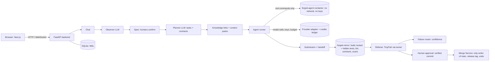

# ForgeIt

*Forged by agents. Checked by a referee.*

**An AI-native collaborative coding workspace.** It turns team discussions into software, coordinates coding agents through shared project intelligence, and verifies their work before it reaches the main product.

## The Pitch
AI coding is fast, but team coding with AI is chaotic. Discussions happen in group chat, and each person's agent works from its own private context. Parallel agents assume different API shapes, they report "done" with no proof, and unverified code lands on main.

ForgeIt runs the whole team loop in one place:

1. **Discuss.** Create a workspace, invite teammates with single-use links, and chat as a team.
2. **Capture.** An observer agent turns the conversation into a living spec. A suggestion becomes a decision only after a human confirms it.
3. **Plan.** The platform proposes tasks, owners, dependencies, and shared contracts (API shapes, schemas, types) before anyone writes code.
4. **See the project map.** A Graph tab shows requirements, decisions, contracts, tasks, parts, files, changes and failures as a linked graph, Obsidian-style. Each agent gets only the slice connected to its task: its relevant files and linked items. Optionally, its edits can be limited to those files.
5. **Build in parallel.** Each teammate's coding agent works in an isolated Docker sandbox on its own clone and branch, with a task-scoped context pack. Agents never hold model keys. They reach models only through the platform's model proxy, which enforces each member's credit budget.
6. **Verify independently.** Submitted work is combined in a mirror build and checked by real commands: build, locked tests, hidden tests (written by a human and never visible to agents), lint, and contract checks. The verdict comes from exit codes, not from what an agent claims.
7. **Referee.** A browser agent (TinyFish) drives the running candidate through user journeys. Only a `pass` verdict counts as a pass.
8. **Route failures.** Failures go to the likely owner with evidence and a confidence level, not blame.
9. **Merge with a human gate.** A human approves every merge, in every verification profile. Every merge is snapshotted and tagged so it can be undone.

```
Chat -> Observer -> Spec (human-confirmed) -> Planner -> Tasks + Contracts
     -> per-task clone + sandbox -> agent (via model proxy) -> Submit
     -> Mirror build -> Checks (locked + hidden tests) -> Referee verdict
     -> pass: human approval -> protected main (snapshot + tag)
     -> fail: Failure Router -> owner + evidence -> resubmit
```

## Stack
FastAPI (Python 3.11), SQLAlchemy 2, SQLite (WAL mode), Next.js (JavaScript), Docker sandboxes behind an internal network, TinyFish referee, Gmail SMTP for invites, and one provider adapter (Claude first, then OpenAI-compatible providers, plus `mock` and Ollama for tests).

## Architecture

See [docs/ARCHITECTURE.md](docs/ARCHITECTURE.md) and the decisions in [docs/adr/](docs/adr/).

## Repository Layout
```
apps/api/       FastAPI service (core, models, schemas, routers, services, llm, workers)
apps/web/       Next.js app (JavaScript)
sandbox/        Dockerfiles for agent and mirror images, proxy config
samples/        Demo target app
docs/           PRD, TRD, ARCHITECTURE, ADRs, source material
scripts/        Helper scripts
.github/        CI workflows
```

## Roadmap
The project is built one stage at a time. See [BUILD_PROMPTS.md](BUILD_PROMPTS.md) for each stage's prompt and acceptance criteria.

| # | Stage | # | Stage |
|---|-------|---|-------|
| 0 | Repo and docs | 13 | Sandboxes, per-task clones and model proxy |
| 1 | Backend skeleton + CI | 14 | Submission and handoff |
| 2 | Database and models | 15 | Mirror integration |
| 3 | Workspaces and invites | 16 | Verification engine, locked and hidden tests |
| 4 | Realtime chat | 17 | Referee and failure routing |
| 5 | Frontend shell | 18 | Human approval, merge and finale demo loop |
| 6 | LLM adapter and credits ledger | 19 | Verification profiles |
| 7 | Observer agent | 20 | Security checks |
| 8 | Spec editor and approval | 21 | Referee journeys from requirements |
| 9 | Planner and contracts | 22 | Hidden-test authoring workflow |
| 10 | Knowledge store | 23 | Demo app and e2e |
| 11 | Context retrieval | 24 | Polish and docs |
| 12 | Git service + protected main | 25 | House key and extra providers |

**Finale slice (MVP):** stages 0 to 18. **Later work:** stages 19 to 25.

## Getting Started
**Prerequisites:** Git 2.40+, Python 3.11, Node.js 20+, and Docker (Docker Desktop with at least 8 GB RAM; on Windows, use the WSL2 backend). For real runs you also need a model key (a free tier such as Gemini, Groq or OpenRouter works, or a Claude key), a TinyFish API key, a tunnel tool, and a Gmail app password. None of these are needed for development: `LLM_PROVIDER=mock` works without keys.

Copy `.env.example` to `.env` (never commit `.env`). Then:
```
docker build -t forgeit-agent:latest sandbox/agent      # the agents' sandbox (see Isolation)
docker build -t forgeit-mirror:latest sandbox/mirror    # the mirror where candidate code is checked

cd apps/api && python -m venv .venv && .venv/Scripts/activate   # macOS/Linux: source .venv/bin/activate
pip install -e ".[dev]"
alembic upgrade head                     # creates data/state/forgeit.db (SQLite); the API also runs this at startup
uvicorn app.main:app --reload            # http://localhost:8000/docs
pytest -q                                # offline tests, no keys needed

cd apps/web && npm install && npm run build && npm start   # http://localhost:3000; passes /api/* on to the backend (BACKEND_URL)
```
Open http://localhost:3000 and start a workspace. Each person gets one login token, shown once. Enter the workspace and pick a model on the **Models** tab: a free tier (Gemini, Groq, OpenRouter, Cerebras, Mistral, GitHub Models, or local Ollama) on your own free key or a shared demo key from `.env`, or Claude on your own key and a budget. Then pick an agent and give it a task. Free tiers cost no credits; keys are stored encrypted and agents never see them. The demo shop (`samples/shop`) comes with locked tests and hidden tests (`samples/shop-holdout`). A blank project begins with a **bootstrap**: the agent writes a short spec, the tests and the first app, and a human approves it to make it the locked original.

Demos: `bash scripts/demo.sh` runs the scripted end-to-end test and the finale loop offline (no keys). `python scripts/finale_demo.py --live` runs the finale loop with a real Claude agent (`ANTHROPIC_API_KEY`, spend capped by `BUDGET`). See [docs/DEMO.md](docs/DEMO.md).

Contributors and AI agents should read [AGENTS.md](AGENTS.md) first.

### Sharing with teammates
The machine that runs the backend and Docker is the host; everyone else only needs a browser. On the host, `cloudflared tunnel --url http://localhost:3000` prints an https address to send to the team, and each person signs in with their own token. Only share the link with teammates and stop the tunnel when you are done. The host stores everyone's keys, so only give a host you trust a key with a small budget.

### Permanent deployment (always on)
ForgeIt needs Docker on the same machine (every agent command and check runs in a container), so it runs on a small Linux server rather than a serverless host. See [ADR-007](docs/adr/ADR-007-always-on-server.md).
1. Create an Ubuntu 22.04 or 24.04 VM with at least 2 vCPUs and 4 GB RAM (for example Oracle Cloud Always Free, DigitalOcean, Hetzner or AWS Lightsail) and allow inbound ports 22, 80 and 443 in its firewall.
2. On the server: `git clone <your repo> forgeit && cd forgeit && bash scripts/deploy/setup-server.sh`. Without a domain it uses the free address `<server-ip>.sslip.io`; with one, point its A record at the server and pass it: `bash scripts/deploy/setup-server.sh forgeit.example.com`.
3. Add your keys to `.env` on the server (`GEMINI_API_KEY`, `TINYFISH_API_KEY`, `SMTP_USER`, `SMTP_APP_PASSWORD`), then `sudo docker compose up -d`.

Caddy issues the HTTPS certificate on the first visit and routes `/api/*` (including the chat WebSocket) to the API. Data lives in `/srv/forgeit/data` on the server: back it up. Update with `git pull && sudo docker compose up -d --build`.

### Isolation (read before running real agents)
- Agent commands run in **Docker** with no network, no keys, all capabilities dropped, memory/CPU/PID limits, only their own clone mounted, and `protected/` (locked tests and contracts) mounted read-only. If Docker or the `forgeit-agent` image is missing, the platform **refuses** to run a real model's commands. `ALLOW_UNSAFE_SANDBOX=true` overrides that on a throwaway machine only; it is not a security boundary.
- Model calls are made by the backend, never from inside the sandbox: keys stay on the host, encrypted at rest (Fernet).
- The database and encryption key live in `PLATFORM_STATE`, a sibling of the workspace data, never inside or above it.
- The mirror runs the candidate's build, tests, lint and contract checks in fresh `forgeit-mirror` containers with no network and no keys, and runs the candidate app in its own container for the referee. Without the image it falls back to the host and every result says `mirror: host (not isolated)`.
- The bash firewall (blocks `..`, platform paths, edits of protected files) is a speed bump. The real wall is the commit-time check that rejects any change to `protected/`.
- Without a TinyFish key and a public address, the referee reports **not run**; it never pretends. `REFEREE_STANDIN=true` enables an offline stand-in for rehearsals, and its verdicts are labelled as not TinyFish's.

### Verified vs not
**Verified offline** (about 230 tests with mock models, scripted agents and a fake TinyFish server):
- invites, roles and access control; chat over WebSocket
- observer → spec confirm/reject/edit (append-only) → planner (acyclic, pinned contracts) → knowledge links → context packs
- per-task start with `TASK_CONTEXT.md`, the handoff from the diff, verification checks with exit codes and logs, profiles, secret scan
- failure routing with confidence and triage; the protected main guard; approval bound to the verified commit; release tags and undo
- the house key caps; the todo-app end-to-end flow

**Verified on the host** (Windows, Docker Desktop):
- the agent sandbox (non-root, no network, read-only `protected/`)
- the mirror containers running the finale loop end to end, using the offline referee stand-in

**Not yet verified** (needs keys or network):
- real Claude agent runs
- the real TinyFish API, its evidence, and the tunnel
- Gmail sending
- pip-audit dependency scans
- Anthropic's terms for lending a key

Per AGENTS.md, do not describe these as working until the real-run test passes.

## Documentation
- [Product Requirements (PRD)](docs/PRD.md)
- [Technical Requirements (TRD)](docs/TRD.md)
- [Architecture](docs/ARCHITECTURE.md) and [ADRs](docs/adr/)
- [Demo guide](docs/DEMO.md) · [Hidden tests threat model](docs/security/hidden-tests-threat-model.md) · [Contributing](CONTRIBUTING.md)
- [Product vision (source)](docs/source/product-vision.docx)

## License
[MIT](LICENSE)
